**🇪🇸 Español** · [🇬🇧 English](README.en.md)

## 👋 About me

Hi, I'm Yago. I just finished **DAM** (Cross-platform Application Development) and I come from **Microcomputer Systems and Networks**, so I'm comfortable both with code and with what lies underneath: machines, networks and systems.

I like building things people actually use: apps that work well, look good and that someone wants to open. I love connecting an interface to its data and understanding what happens inside at every step.

## 🧪 Currently learning

## 🛠️ Stack

| | |
|:--|:--|
| **Languages** |       |
| **Mobile** |     |
| **Web & backend** |      |
| **Databases** |    |
| **Tools** |       |

## 🚀 Projects

<table>
  <tr>
    <td width="33%" valign="top">
      <h3>💸 Zenta</h3>
      
Personal finance app to keep your money clear and under control. Available in Spanish and English, with in-app subscriptions.

      
<code>Expo</code> · <code>React Native</code> · <code>TypeScript</code> · <code>Supabase</code>

      
<a href="https://zenta.ventoagency.es">Visit website →</a>

    </td>
    <td width="33%" valign="top">
      <h3>🏠 BiziMatch</h3>
      
My final degree project: an Android app to find flatmates using a compatibility algorithm.

      
<code>Flutter</code> · <code>Dart</code> · <code>Android</code>

      
<a href="https://github.com/yagoduran/bizimatch_flutter">View repository →</a>

    </td>
    <td width="33%" valign="top">
      <h3>⚙️ Web automation</h3>
      
Scripts and workflows to connect services, data and repetitive tasks, and take work off my plate.

    </td>
  </tr>
</table>

## 🎓 Education

- **Cross-platform Application Development (DAM)**: completed ✅
- **Microcomputer Systems and Networks (SMR)**: completed ✅

## 🌍 Languages

Spanish · Basque · English · Galician

## 📬 Let's talk

