**🇪🇸 Español** · [🇬🇧 English](README.en.md)

## 👋 Sobre mí

Hola, soy Yago. Acabo de terminar **DAM** (Desarrollo de Aplicaciones Multiplataforma) y vengo de **Sistemas Microinformáticos y Redes**, así que me muevo bien tanto en el código como en lo que hay debajo: equipos, redes y sistemas.

Me gusta construir cosas que se usen de verdad: apps que funcionen bien, que se vean bien y que alguien tenga ganas de abrir. Me flipa conectar una interfaz con sus datos y entender qué pasa por dentro en cada paso.

## 🧪 Ahora mismo estoy aprendiendo

## 🛠️ Stack

| | |
|:--|:--|
| **Lenguajes** |       |
| **Móvil** |     |
| **Web y backend** |      |
| **Bases de datos** |    |
| **Herramientas** |       |

## 🚀 Proyectos

<table>
  <tr>
    <td width="33%" valign="top">
      <h3>💸 Zenta</h3>
      
App de finanzas personales para tener tu dinero claro y bajo control. Disponible en español e inglés, con suscripciones dentro de la app.

      
<code>Expo</code> · <code>React Native</code> · <code>TypeScript</code> · <code>Supabase</code>

      
<a href="https://zenta.ventoagency.es">Ver web →</a>

    </td>
    <td width="33%" valign="top">
      <h3>🏠 BiziMatch</h3>
      
Mi Trabajo de Fin de Grado: una app Android para encontrar compañeros de piso gracias a un algoritmo de compatibilidad.

      
<code>Flutter</code> · <code>Dart</code> · <code>Android</code>

      
<a href="https://github.com/yagoduran/bizimatch_flutter">Ver repositorio →</a>

    </td>
    <td width="33%" valign="top">
      <h3>⚙️ Automatizaciones web</h3>
      
Scripts y flujos para conectar servicios, datos y tareas repetitivas, y quitarme trabajo de encima.

    </td>
  </tr>
</table>

## 🎓 Formación

- **Desarrollo de Aplicaciones Multiplataforma (DAM)**: terminado ✅
- **Sistemas Microinformáticos y Redes (SMR)**: terminado ✅

## 🌍 Idiomas

Castellano · Euskera · English · Galego

## 📬 Hablemos

